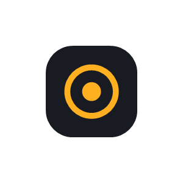
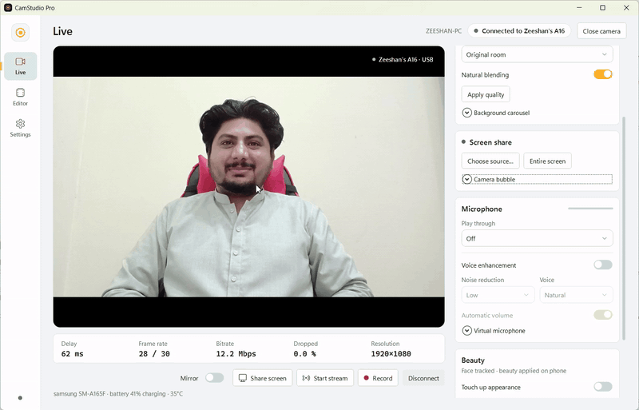
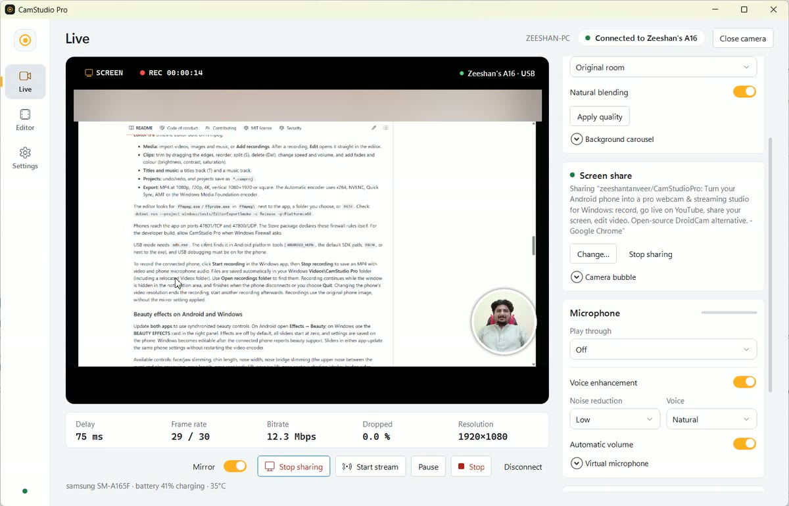
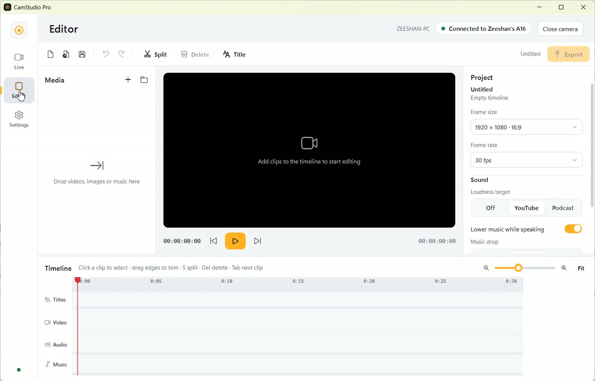
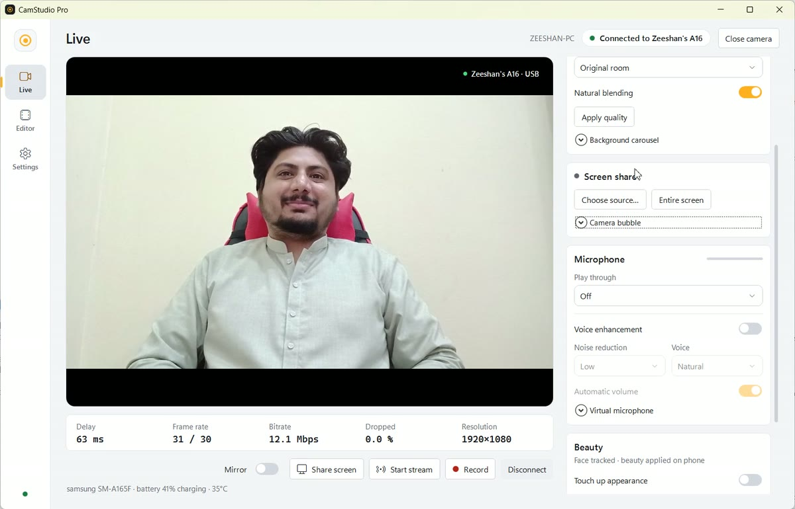
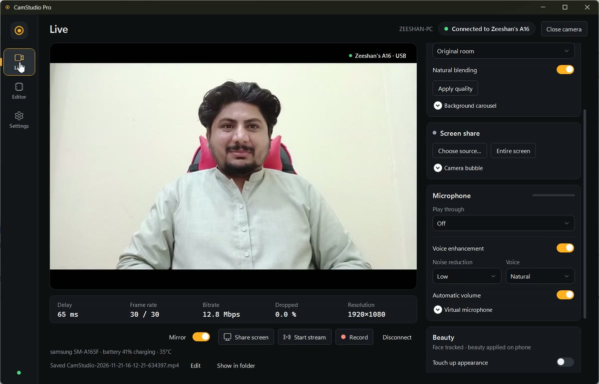
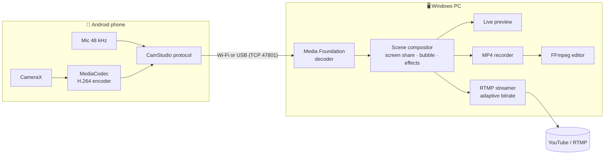

<div align="center">



# CamStudio Pro

### Turn your Android phone into a pro webcam and streaming studio for Windows

Record, share your screen, go live on YouTube, and edit your videos, all with your phone's camera
and mic over Wi-Fi or USB.<br>**Free and open source. No watermark, no account, no cloud.**

[](https://github.com/zeeshantanveer/CamStudioPro/stargazers)
[](LICENSE)
[](#quick-start)
[](CONTRIBUTING.md)

[**Quick start**](#quick-start) · [**Features**](#features) · [**How it works**](#how-it-works) · [**FAQ**](#faq) · [**Guide**](docs/GUIDE.md) · [**Contribute**](CONTRIBUTING.md)

<br>



<sub>Real recording of the Windows app with a Samsung phone over USB: 1080p at 30 fps, about 70 ms delay, 0% dropped frames.</sub>

</div>

---

## Why CamStudio Pro?

Your phone's camera is almost always better than your laptop's webcam. Most phone-webcam apps
(DroidCam, Iriun and similar) are closed source, and some limit HD or add a watermark unless you
pay. CamStudio Pro is **open source** and goes beyond a plain webcam: it's a small
**recording and streaming studio**.

- 🎥 **1080p at 30 fps** from your phone's camera, with about 60–70 ms delay over USB
- 🔴 **Go live on YouTube** (or any RTMP server) straight from the app, with no OBS needed
- 🖥️ **Share your screen** with your face in a camera bubble
- ✂️ **Edit** the result in the built-in timeline editor
- 🔒 **Private by design**: video and audio never leave your local network

> **⭐ If CamStudio Pro is useful to you, please star the repo.** Stars help other people find the project.

## Features

| | Feature | What you get |
|:-:|---|---|
| 📱 | **Phone as webcam** | Low-latency H.264 video and 48 kHz audio over Wi-Fi or USB. Auto-discovery, QR pairing or a typed IP address. |
| ⏺️ | **Recording** | One-click MP4 recording with pause/resume. Open a recording straight in the editor. |
| 🔴 | **Live streaming** | Built-in YouTube/RTMP(S) encoder with adaptive bitrate (240p–1080p) that follows your upload speed and reconnects on its own. |
| 🖥️ | **Screen sharing** | Share a screen or window, with your camera in a round bubble. Works in the preview, recordings and streams. |
| ✂️ | **Video editor** | Timeline editor powered by FFmpeg: trim, split, speed, fades, colour, titles, music. Export up to 4K, vertical or square, with NVENC, Quick Sync or AMF. |
| 🎙️ | **Voice enhancement** | Real-time noise suppression (RNNoise) and automatic volume. |
| ✨ | **Beauty touch-up** | Gentle skin smoothing, controlled from the phone or the PC. |
| 🏞️ | **Virtual backgrounds** *(beta)* | Blur or replace your background. Being improved; see the [roadmap](#roadmap). |
| 🌗 | **Light and dark themes** | Follows Windows by default. Can start with Windows and reconnect phones automatically. |

## Screenshots

<table>
  <tr>
    <td width="50%"><p align="center"><b>Screen sharing with a camera bubble</b></p></td>
    <td width="50%"><p align="center"><b>Built-in video editor</b></p></td>
  </tr>
  <tr>
    <td width="50%"><p align="center"><b>Live 1080p preview</b></p></td>
    <td width="50%"><p align="center"><b>Dark theme</b></p></td>
  </tr>
</table>

## Quick start

**You need:** Windows 11, an Android 8.0+ phone, the [.NET 10 SDK](https://dotnet.microsoft.com/download),
and JDK 17 with Android SDK 35 to build the phone app. [FFmpeg](https://ffmpeg.org/download.html) is
needed for the editor and live streaming.

```powershell
git clone https://github.com/zeeshantanveer/CamStudioPro.git
cd CamStudioPro

windows\build.ps1                                  # Windows app -> windows\dist\CamStudioPro\CamStudioPro.exe
android\gradlew.bat -p android :app:assembleDebug  # Phone app   -> android\app\build\outputs\apk\debug\app-debug.apk
```

1. Install the APK on your phone and start **CamStudio Pro** on both devices.
2. Scan the QR code shown on the PC, or plug in a USB cable with USB debugging on.
3. Your phone camera appears in the app. Record, share your screen or go live.

No phone handy? `python windows\tools\fake_phone.py` streams a test pattern over the real protocol.

> 📦 **Ready-made installers are coming to [Releases](https://github.com/zeeshantanveer/CamStudioPro/releases).**
> Click **Watch → Custom → Releases** to be notified.

## How it works



The phone finds the PC by UDP broadcast (port 47800), QR code, typed IP or `adb reverse` over USB.
The wire protocol is documented in [docs/PROTOCOL.md](docs/PROTOCOL.md).

| Folder | What's inside |
|---|---|
| [`android/`](android) | Phone app: Kotlin, Jetpack Compose, CameraX, MediaCodec |
| [`windows/`](windows) | PC app: WPF on .NET 10, Media Foundation, FFmpeg, RNNoise |
| [`docs/`](docs) | [User & developer guide](docs/GUIDE.md), [protocol](docs/PROTOCOL.md), performance notes |

## FAQ

<details>
<summary><b>Is it really free? Is there a watermark?</b></summary>

Yes, it's free and MIT licensed. There's no watermark, no account and no time limit.
</details>

<details>
<summary><b>Does my video go to the internet?</b></summary>

No. Video and audio go directly from your phone to your PC over your local network or USB cable.
The only exception is when **you** start a YouTube/RTMP live stream.
</details>

<details>
<summary><b>Wi-Fi or USB: which should I use?</b></summary>

USB gives the lowest and steadiest delay (about 60–70 ms at 1080p30 in our tests) and charges the
phone. Wi-Fi is wireless and works anywhere on the same network.
</details>

<details>
<summary><b>Can I use it in Zoom, Teams or Google Meet?</b></summary>

The developer build includes a Windows virtual camera ("CamStudio Pro Windows Virtual Camera").
See [Use the phone camera in Zoom](docs/GUIDE.md#use-the-phone-camera-in-zoom-windows-developer-build).
</details>

<details>
<summary><b>Which phones work?</b></summary>

Any Android 8.0+ phone with a working camera should work. Please share your phone model and how
well it works in [Discussions](https://github.com/zeeshantanveer/CamStudioPro/discussions).
</details>

<details>
<summary><b>Is there an iPhone, macOS or Linux version?</b></summary>

Not yet. Those are on the wish list; see the roadmap below. Contributions are very welcome.
</details>

## Roadmap

- [x] 1080p phone camera over Wi-Fi and USB
- [x] Recording, screen sharing with a camera bubble, video editor
- [x] YouTube/RTMP live streaming with adaptive bitrate
- [x] Voice enhancement and beauty touch-up
- [ ] Ready-made installers and signed APK in Releases
- [ ] More natural virtual backgrounds (currently beta)
- [ ] Virtual camera in the Microsoft Store build
- [ ] Multiple phones and camera switching
- [ ] Translations
- [ ] macOS / Linux client

Have an idea? [Open a feature request](https://github.com/zeeshantanveer/CamStudioPro/issues/new/choose).

## Contributing

All kinds of contributions are welcome: code, testing on your phone, docs, translations and design.
Start with [CONTRIBUTING.md](CONTRIBUTING.md), and see the full [user & developer guide](docs/GUIDE.md)
for build, packaging and test details.

## Star history

<a href="https://star-history.com/#zeeshantanveer/CamStudioPro&Date">
  
</a>

## License

[MIT](LICENSE). CamStudio Pro uses FFmpeg (not bundled), RNNoise, MediaPipe and other open-source
components; see the `THIRD-PARTY-*` files for their licenses.

<div align="center">
<br>
<b>Made with ❤️ for creators, teachers and remote workers.</b><br>
If this project helps you, <a href="https://github.com/zeeshantanveer/CamStudioPro/stargazers">give it a ⭐</a>. It really helps!
</div>
